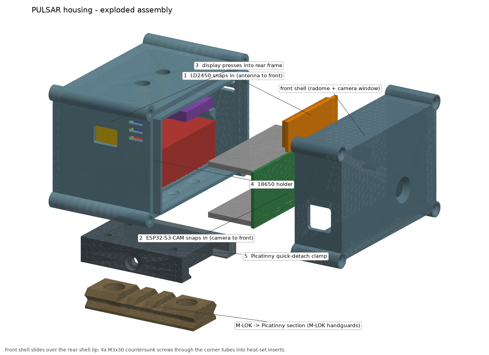
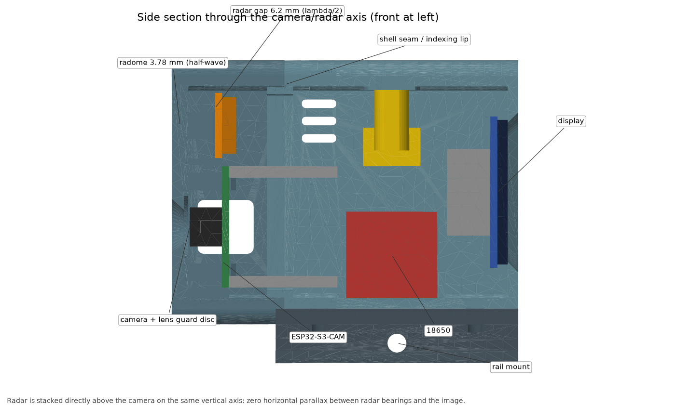
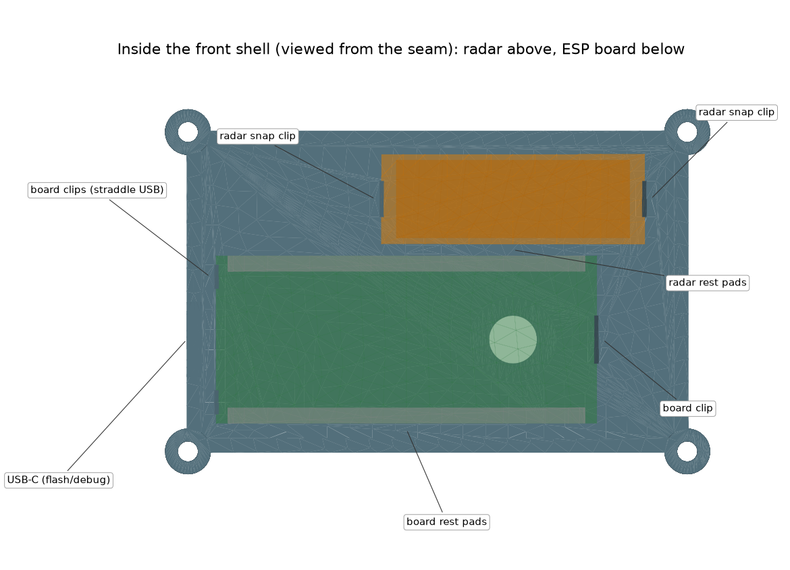
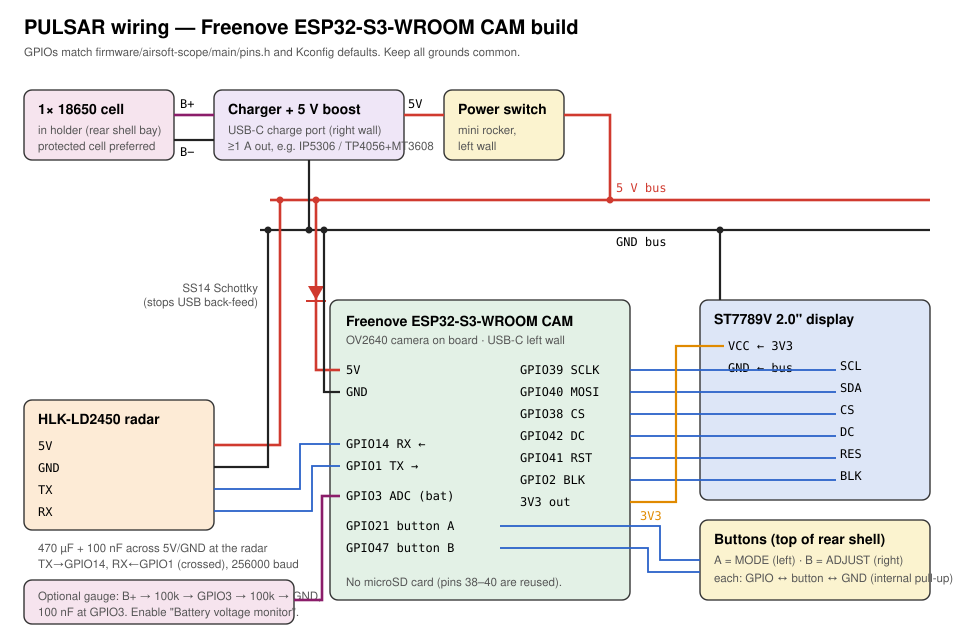

# PULSAR prototype housing

Parametric, support-free 3D-printed enclosure for the PULSAR radar scope, with
quick-detach mounting for a Tokyo Marui MWS (Picatinny or M-LOK handguard).



| | |
|---|---|
| Outer size | 84 × 80 × 54 mm (91 mm across the corner tubes), plus a 13 mm clamp |
| Printed volume | ~110 cm³ solid across all five parts (well under 150 g printed) |
| Fasteners | 4× M3×30 countersunk, 8× M3 heat-set inserts, 4× M3×8 countersunk, 1× M4×30 + nylock nut, 2× M5 M-LOK T-nut screws (M-LOK only) |

Everything is generated by [`pulsar_housing.py`](pulsar_housing.py). The STLs in
[`stl/`](stl/) are the defaults. **Measure your modules first** (see
[Fit to your parts](#fit-to-your-parts)) and regenerate if they differ.

## Parts to print

| File | Qty | Orientation (already set) | Notes |
|---|---|---|---|
| `pulsar_front_shell.stl` | 1 | front face down | The front wall **is the radome**. It must print 100% solid; see settings below |
| `pulsar_rear_shell.stl` | 1 | rear (display) face down | Display window, battery bay, controls |
| `pulsar_mount_picatinny.stl` | 1 | top face down, jaws up | Clamp body with the fixed jaw |
| `pulsar_mount_picatinny_jaw.stl` | 1 | outer face down | Sliding jaw (M4 nut trap) |
| `pulsar_mlok_picatinny_adapter.stl` | 0–1 | rail top down | Only for an M-LOK handguard. Stays on the rifle |

### Bambu Lab X2D settings

All five parts fit on one plate. Nothing needs supports.

| Setting | Value |
|---|---|
| Material | **ASA** (best: UV and heat on a dark rifle; the X2D's enclosure handles it) or PETG HF. **Do not use CF/GF-filled or metal/glow filaments** for the front shell, because the fibres detune and absorb 24 GHz. Plain PLA works for a bench prototype |
| Nozzle / layer | 0.4 mm / 0.20 mm |
| Walls | 4 |
| Top / bottom shell | 5 top layers; **bottom shell thickness ≥ 4.0 mm (20 layers)** so the 3.78 mm front wall prints fully solid. A solid, void-free radome is what makes the half-wave window work |
| Infill | 30% gyroid |
| Seam | Back or aligned (keep it off the front face) |
| Brim | Not needed. Optional on the rear shell with ASA |
| Dual nozzle | Optional: print the clamp in a contrasting colour. Keep the front shell single-material |

Install the M3 heat-set inserts (4 in the rear-shell corner tubes, 4 in the top
of the clamp body) with a soldering iron at about 230 °C for PETG or 250 °C for
ASA.

## Hardware

| Item | Qty | Where |
|---|---|---|
| Freenove ESP32-S3-WROOM CAM (N16R8) | 1 | front shell, lower clips |
| HLK-LD2450 | 1 | front shell, upper clips |
| 2.0" ST7789V 240×320 SPI module (≈58 × 35 mm PCB) | 1 | rear shell frame |
| 1× 18650 holder (≈77 × 21 × 20 mm) + protected 18650 cell | 1 | rear shell bay |
| 1S charger + 5 V boost module with USB-C (≥1 A) | 1 | rear shell right-wall shelf |
| Mini rocker switch (KCD11-style, 13.2 × 8.8 mm cut-out) | 1 | rear shell left wall |
| 7 mm momentary panel buttons (R13-507 style) | 2 | rear shell top |
| Clear polycarbonate or acrylic disc, Ø14 × 1 mm | 1 | camera window (glue in from inside) |
| SS14 Schottky diode, 470 µF + 100 nF capacitors | 1 each | power wiring |
| Optional: 2× 100 kΩ + 100 nF | — | battery gauge divider |

## Fit diagrams





The radar is stacked **directly above the camera on the same vertical axis**,
so the radar bearing and the camera image share one horizontal origin. There's
no left/right parallax to calibrate out. The LD2450 sits λ/2 (6.2 mm) behind a
half-wave front wall (λ/(2√εr) = 3.78 mm for εr = 2.7). That's the low-reflection
radome condition, and both values are computed from `radar_freq_ghz` and `radome_er`.

## Assembly

Work on the bench in **Simulation** mode first (see the top-level README). Then:

1. **Inserts.** Press the 4 rear-shell and 4 clamp inserts.
2. **Mount to the rear shell.** Fasten the clamp body to the rear shell with
   4× M3×8 countersunk screws from *inside* the rear shell floor. Do this before
   anything else goes in the rear shell: the rear holes sit just in front of the
   display frame. Fit the sliding jaw, the M4×30 bolt, and a nylock nut, and
   leave the bolt loose.
3. **Wire harness.** Solder or crimp per the [wiring diagram](#wiring). Leave
   ~40 mm service loops between the two shells.
4. **Display.** Glass first, press the module into the frame on the rear wall
   until all four barbs click. Header end toward the left (-X) side.
5. **Controls.** Fit the two buttons through the top (nuts inside), the rocker
   switch into the left wall, and the charger module on the right-wall shelf
   with its USB-C in the slot. Fit the display before the buttons, because the
   button bodies block the display's insertion path.
6. **Battery.** Tilt the 18650 holder over the low front lip into the bay
   against the rear stop. A strip of foam tape underneath stops rattle.
7. **Camera window.** Glue the Ø14 mm disc into the counterbore inside the
   front shell. Use a tiny bead of CA gel at the rim only and keep it off the lens area.
8. **Radar.** Antenna side to the front, press the LD2450 into the two upper
   clips (connector toward the back) until it seats on the two rest pads.
9. **ESP board.** Camera side to the front, USB end to the left, press the
   board into the three lower clips. The camera lens should sit just behind the
   window disc.
10. **Close.** Slide the front shell over the rear shell's indexing lip, then
    fit 4× M3×30 countersunk screws through the front corner tubes into the
    rear inserts.
11. **Firmware settings** (`idf.py menuconfig`): mode *Live*, camera
    *ESP32-S3-CAM*, display rotation *0*. If the image is mirrored or upside
    down, toggle *Mirror camera image horizontally* / *Flip camera image
    vertically*.
12. **Boresight.** Hold **A** (MODE) to enter calibration. Have a teammate walk
    across the scene about 4 m out and tap **A**/**B** to move the radar marker
    onto them in 0.5° steps. Hold **A** again to save it to flash.

### Button reference

| | Short press | Long press (~1 s) |
|---|---|---|
| **A** MODE (left) | brightness 15/40/70/100% | enter / save+exit boresight calibration |
| **B** ADJUST (right) | declutter (radar-backed contacts only) | in calibration: reset offset |
| In calibration | A = −0.5°, B = +0.5° | |

## Mounting on a Tokyo Marui MWS

* **Picatinny handguard or upper rail.** Open the clamp, drop it over the rail
  with the M4 bolt in a recoil slot, push the housing forward against the slot
  edge, and tighten the bolt firmly. A quarter turn past snug is enough on a
  printed clamp.
* **M-LOK handguard.** Fit the printed M-LOK→Picatinny section in two adjacent
  M-LOK slots (lugs into the slots, M5 button-head screws into standard M-LOK
  T-nuts, 10 mm long for a ~2.5 mm handguard wall). Make sure the screws don't
  reach the barrel. The section stays on the handguard, and the scope clamps
  onto it like any Picatinny rail, so swapping between rifles is tool-free
  apart from the clamp bolt.
* **Placement.** Mount at 12 o'clock ahead of the main optic, or at 9/3 o'clock.
  Keep the front face clear of the outer barrel, flash hider, tracer unit, and
  lasers. Metal in front of the radome blinds the radar. The default 120 cm
  minimum range ignores the rifle itself.
* GBB recoil is mild, but check the clamp bolt after the first few magazines.

## Wiring



| From | To | Notes |
|---|---|---|
| 18650 holder B+/B− | charger/boost BAT+/BAT− | |
| boost 5 V out | rocker switch → 5 V bus | the switch cuts the load; charging still works with it off |
| 5 V bus | LD2450 5 V, and ESP 5V via SS14 diode | the diode stops USB from back-feeding the boost while flashing |
| 5 V bus at the radar | 470 µF + 100 nF to GND | the LD2450 draws pulsed current |
| LD2450 TX / RX | GPIO14 / GPIO1 | crossed UART, 256000 baud |
| Display SCL/SDA/CS/DC/RES/BLK | GPIO39/40/38/42/41/2 | VCC from ESP 3V3. BLK is PWM-dimmed |
| Button A / B | GPIO21 / GPIO47 → GND | internal pull-ups |
| Battery sense (optional) | B+ → 100 kΩ → GPIO3 → 100 kΩ → GND | 100 nF on GPIO3. Enable *Battery voltage monitor* |

## Fit to your parts

Module outlines vary between sellers. Before printing, measure these and pass
them with `--set` (for example `--set cam_stack=8.2 --set esp_l=62.5`):

| Parameter | Default | Measure |
|---|---|---|
| `esp_l`, `esp_w` | 63.6, 28.0 | ESP board outline |
| `cam_from_end` | 14.0 | camera centre to the board end **opposite** the USB port |
| `cam_stack` | 7.5 | board front face to the front of the lens |
| `radar_l`, `radar_w` | 44.0, 15.0 | LD2450 outline |
| `disp_pcb_l`, `disp_pcb_w` | 58.0, 35.0 | display PCB outline |
| `disp_active_l/w`, `disp_active_dx/dz` | 40.8 × 30.6, 0/0 | visible area and its offset from the PCB centre |
| `bat_l`, `bat_w`, `bat_h` | 77, 21, 20 | battery holder |
| `radome_er` | 2.7 | ≈2.5 ASA/ABS, 2.6–2.8 PETG, 2.7–3.0 PLA |

```powershell
cd hardware/housing
python -m venv .venv
.venv\Scripts\pip install -r requirements.txt
.venv\Scripts\python pulsar_housing.py                      # writes stl/ + manifest.json
.venv\Scripts\python render_views.py                        # refreshes img/*.png
```

Every run checks the following and exits non-zero on failure:

* Each part is one watertight body.
* None of the electronics keep-outs intersect the shells (radar, board, camera,
  headers, display, battery, switch, charger, buttons).
* The insertion paths are clear for the radar, the board and the display. Only
  the flexing snap barbs may touch them.
* The two shells don't overlap.
* The clamp clears the rail it grips.

`stl/manifest.json` records the parameters and derived dimensions used.

## Known limits of this prototype

* Default module dimensions are typical values, not measured from your parts.
  Print the front shell first and test-fit the boards before committing to the
  rear shell.
* Splash-resistant, not sealed: the vents, buttons and USB openings are open.
  Add a silicone bead at the seam and tape over the USB ports for wet games.
* The camera window disc takes BB hits at the front. Polycarbonate is strongly
  preferred over acrylic.
